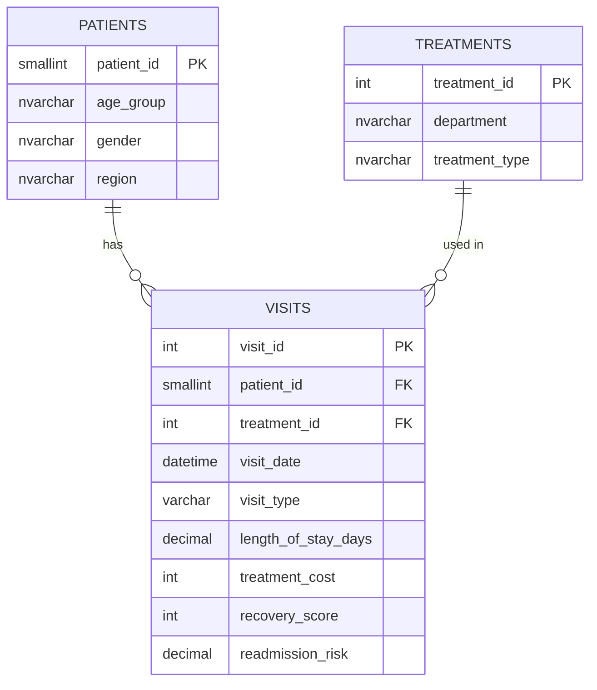

# Healthcare Patient Analytics – SQL Server

## 📌 Project Overview

This project focuses on analyzing healthcare data using **Microsoft SQL Server** to uncover insights into patient demographics, hospital visits, treatment costs, revenue, recovery scores, and readmission risk.

The project answers **25 business-driven questions** using SQL, covering basic queries, aggregations, joins, CTEs, subqueries, correlated subqueries, and window functions.

## 🎯 Business Objectives

- Analyze patient demographics and regional distribution.
- Understand hospital visit patterns.
- Analyze treatment costs and total revenue.
- Compare hospital department performance.
- Evaluate patient recovery scores.
- Analyze patient readmission risk.
- Apply SQL concepts to solve real-world business problems.

## 📊 Dataset

**Source:** [Healthcare Patient Analytics Dataset – Kaggle](https://www.kaggle.com/datasets/abbas829/healthcare-patient-analytics-dataset)

The raw CSV dataset was imported into SQL Server, cleaned, and normalized into three tables.

| Table | Records | Description |
|---|---:|---|
| Patients | 5,000 | Patient demographic information (age group, gender, region) |
| Visits | 5,000 | Visit details, including date, visit type, length of stay, treatment cost, recovery score, and readmission risk |
| Treatments | 20 | Unique department and treatment type combinations |

**Dataset Period:** January – July 2022
## 🗂️ Database Schema



## 🔄 Project Workflow

1. Downloaded the healthcare dataset from Kaggle.
2. Imported the raw CSV file into SQL Server.
3. Performed data cleaning by checking missing values and duplicate visits.
4. Normalized the data into three tables: Patients, Treatments, and Visits.
5. Created relationships between tables using appropriate keys.
6. Developed 25 business-driven SQL queries.
7. Analyzed the results to identify meaningful business insights.

## 🛠️ Tools & Technologies

- Microsoft SQL Server
- SQL Server Management Studio (SSMS)
- SQL

## 🧠 SQL Concepts Used

- SELECT, WHERE, ORDER BY
- GROUP BY and HAVING
- Aggregate Functions (COUNT, SUM, AVG, MIN, MAX)
- INNER JOIN and LEFT JOIN
- CASE Statements
- Common Table Expressions (CTEs)
- Subqueries and Correlated Subqueries
- EXISTS and NOT EXISTS
- Window Functions:
  - RANK()
  - DENSE_RANK()
  - ROW_NUMBER()
- PARTITION BY
- SQL Date Functions

## 🔍 Business Questions

The project answers the following 25 business questions:

1. How many unique patients visited the hospital?
2. How many patients belong to each gender?
3. Which region has the highest number of patients?
4. Which department treated the highest number of patients?
5. Which treatment type is used most frequently?
6. Which department generated the highest total treatment revenue?
7. Which department has the highest average treatment cost?
8. Which region generated the highest total treatment revenue?
9. Which month recorded the highest number of patient visits?
10. Who are the top 10 patients by total treatment cost?
11. Which departments have an average treatment cost greater than ₹55,000?
12. Which departments have more than 1,000 patient visits?
13. Which treatment types generated more than ₹69,000,000 in total revenue?
14. How can patients be classified based on their recovery score?
15. How can patients be classified based on their readmission risk?
16. How can departments be ranked by total treatment revenue?
17. What are the top 3 departments by total treatment revenue?
18. What is the highest treatment cost recorded in each department?
19. What are the top 2 highest treatment-cost records in each department, including ties?
20. Which patients have a treatment cost higher than the overall average?
21. Which departments have total revenue greater than the average department revenue?
22. Which patients have a treatment cost higher than the average of their own department?
23. Which patients have at least one hospital visit?
24. Which patients have never visited the hospital?
25. Which departments have an average readmission risk above 0.28?

## 💡 Key Insights

The analysis revealed the following insights:

- **Patient Overview:** The dataset contains 5,000 patients and 5,000 hospital visits from January to July 2022.
- **Total Revenue:** Approximately ₹274.5 million in total treatment revenue, with an average treatment cost of ₹54,900 per visit.
- **Gender Distribution:** 2,508 male patients and 2,492 female patients, showing an almost equal distribution.
- **Regional Analysis:** The West region recorded the highest number of patients (1,290) and the highest revenue (approximately ₹70.8 million).
- **Department Performance:** Orthopedics led in patient volume (1,058) and total revenue (approximately ₹58.1 million).
- **Average Treatment Cost:** Neurology recorded the highest average treatment cost (₹55,762), while General Medicine had the lowest (₹53,506).
- **Treatment Analysis:** Observation was the most frequently used treatment (1,270 patients), while Surgery generated the highest revenue (approximately ₹69.8 million).
- **Monthly Visits:** January, March, and May recorded the highest number of visits, with 744 visits each.
- **Readmission Risk:** 60 patients (1.2%) were classified as high risk (0.7 or above), while 1,092 patients were classified as medium risk. The average readmission risk was approximately 0.28.
- **Patient Recovery:** 542 patients achieved an Excellent recovery score (90+), while only 81 patients fell into the Poor recovery category (below 50).
- **Visit Validation:** Every patient had exactly one visit. Therefore, the NOT EXISTS query returned zero patients without hospital visits.

## ▶️ How to Run This Project

Follow these steps to execute the project in SQL Server:

1. Download the dataset from the Kaggle source.
2. Open `Patient_analytics_queries.sql` in SQL Server Management Studio (SSMS).
3. Execute the setup section to create the database and the raw `PatientAnalytics` table.
4. Import the CSV file into the `PatientAnalytics` table.

   **To import the CSV:**
   - Right-click the database in SSMS.
   - Select **Tasks → Import Flat File**.
   - Follow the import wizard.

5. Verify the imported visit dates using:

   ```sql
   SELECT MIN(visit_date), MAX(visit_date)
   FROM PatientAnalytics;
   ```

6. Execute the remaining SQL script from top to bottom to create the Patients, Treatments, and Visits tables.
7. Run the 25 SQL queries to explore the business questions and insights.

**Note:** The dates in the original dataset are in day-month-year format. Verify the date conversion during import.

## 📁 Project Structure

```text
Healthcare-Patient-Analytics-SQL/
│
├── Patient_analytics_queries.sql
│
└── README.md
```

## 👨‍💻 Author

**Anil Kumar Chinthalapudi**

Aspiring Data Analyst | SQL | Power BI | Excel | Python

**GitHub:** [Anilkumar7981](https://github.com/Anilkumar7981)

---

⭐ If you find this project useful, feel free to explore the SQL queries and insights!
